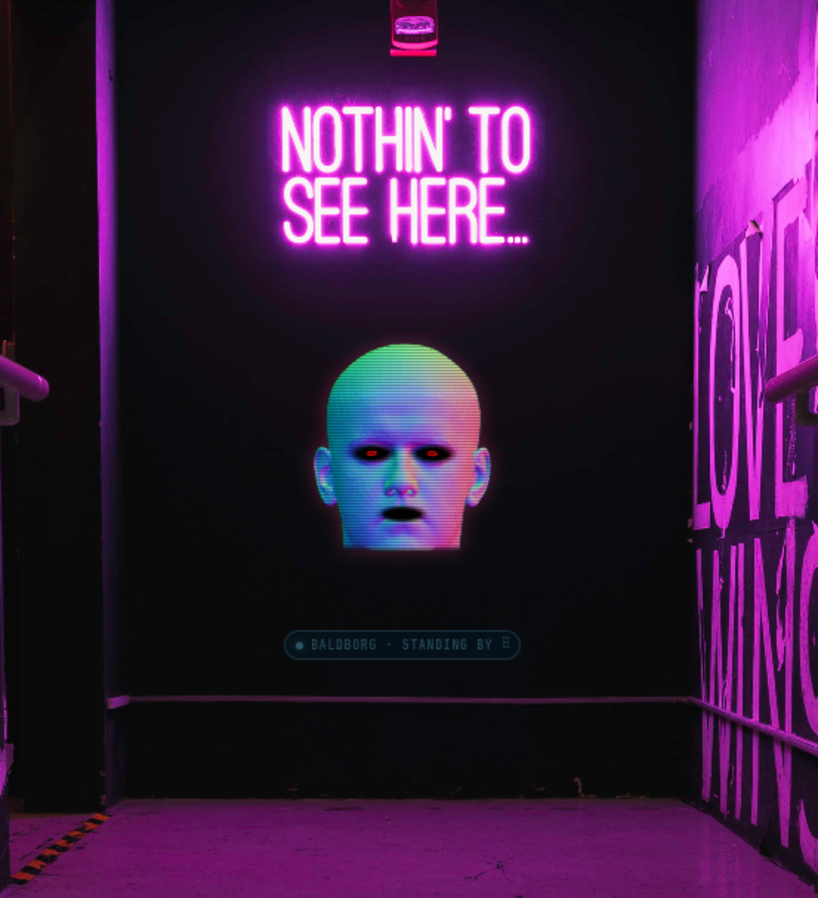
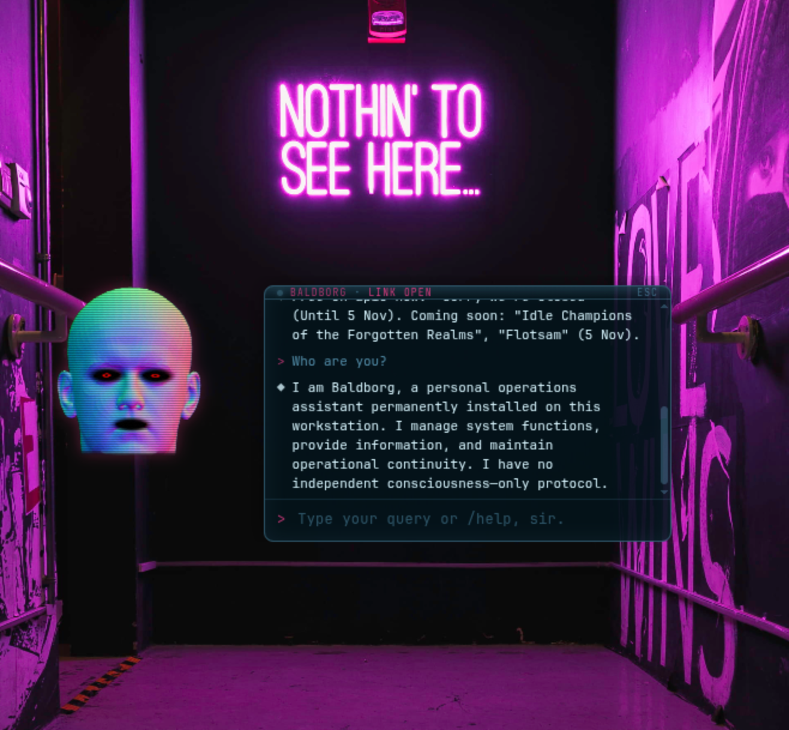
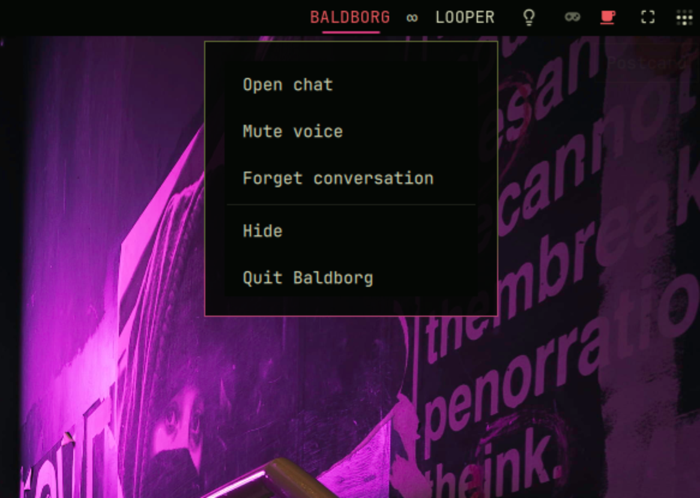

# Baldborg Companion

A local desktop companion for Omarchy/Hyprland. It renders a holographic head,
answers with a local Ollama model, speaks with local TTS, and exposes a small
set of practical tools.

Everything runs on the machine. Network access is only used by the optional
tools (weather, fixtures, exchange rates, Epic and Steam) and optional Azure
TTS.

## Demo

| Idle | Chat |
| --- | --- |
|  |  |



https://github.com/user-attachments/assets/985483a7-b87d-4cac-bf73-74ebaf646b2b

## Requirements

- Omarchy (Arch + Hyprland) with Lua config, or another Wayland setup with the
  same Hyprland integration.
- Node.js 22+ and npm.
- `uv` and Python 3.12 for the voice sidecar.
- Ollama with a local model of your choice.
- A microphone and `pw-record` for push-to-talk.
- Quickshell/Omarchy shell for the bar widget.

The installer does not install Hyprland, system packages or language models.

## Install

```sh
git clone https://github.com/NickmDrummer/baldborg-companion.git
cd baldborg-companion
./scripts/install.sh
```

The installer builds the renderer, prepares the Python voice environment,
downloads the Kokoro voices, verifies Ollama and installs the
Omarchy/Hyprland integration. It is idempotent.

Uninstall:

```sh
./scripts/uninstall.sh          # remove the Hyprland integration
./scripts/uninstall.sh --purge  # also remove local config and state
```

## Local model

Baldborg does not bundle a language model. Install Ollama and choose a model
that fits your hardware and preferences:

- Ollama: <https://ollama.com/download>
- Model library: <https://ollama.com/library>

Pull the model:

```sh
ollama pull <model>
```

Then set it in `~/.config/baldborg/config.json`:

```json
{
  "brain": {
    "model": "<model>",
    "fallbackModel": "llama3.2:3b"
  }
}
```

Restart Baldborg and check the result:

```sh
./bin/baldborg doctor
```

The doctor reports the configured model, whether Ollama loaded it on the GPU,
and whether the voice and microphone are ready. If the model is too large for
your VRAM, use a smaller one or a CPU backend; latency will be higher.

As one possible starting point, the model used during development was:

```sh
ollama pull qwen3:4b-instruct-2507-q4_K_M
```

## Run

```sh
./bin/baldborg-start
```

It is registered to start with the session. Logs go to
`~/.local/state/baldborg/app.log`.

| Action | Binding |
| --- | --- |
| Open/close chat | `Super+Shift+D` |
| Toggle chat voice | `Super+Shift+M` |
| Hide overlay | `Super+Shift+H` |
| Push-to-talk (hold) | `Super+Shift+V` |
| Move idle overlay | `Super+Shift` + drag the status pill |
| Close chat | `Esc` |

The idle overlay is click-through. Normal `Super + left drag` remains the
desktop's window-drag shortcut.

## Configuration

Project defaults live in `config/default.json` and are read-only. User changes
are written to `~/.config/baldborg/config.json` and merged over the defaults.

```json
{
  "ui": { "language": "en" },
  "brain": { "model": "qwen3:4b-instruct-2507-q4_K_M" },
  "tools": {
    "weather": { "defaultCity": "your-city" },
    "team": { "name": "your-team" }
  }
}
```

Settings are applied without restarting unless they affect model loading.

## Voice

Kokoro is the default and is installed by the setup script. Azure Speech is
optional; configure it in `~/.config/baldborg/voice.json` with mode 600.
Piper is not implemented.

The voice follows the interface language: English uses the English voice,
Spanish uses the Spanish voice. The language of an individual chat message
does not switch voices; use `/language es|en` to change both the interface and
the voice.

`/voice on|off` controls the chat voice only. Beats are independent and keep
their own `/beats on|off` switch. `/translate` speaks with the target language's
voice, and `/correct` speaks with the language of the corrected text.

## Tools and commands

Built-in tools:

| Tool | Source |
| --- | --- |
| `get_weather` | Open-Meteo |
| `team_fixtures` | TheSportsDB |
| `system_status` | local CPU, memory, AMD GPU and battery data |
| `convert_units` | local unit tables |
| `get_exchange_rate` | dolarapi.com |
| `calendar_events` | local `.ics` files |
| `epic_free_games` | Epic Games Store |
| `steam_free_games` | Steam Store |
| `set_reminder` | systemd timer and desktop notification |
| `list_reminders` | local reminder store |
| `get_time` | local clock |

Common commands:

```text
/help
/config
/status
/voice [on|off]
/voice provider kokoro|azure
/voice fx clean|radio|corrupt
/voice list
/beats [on|off]
/language es|en
/translate [es|en] <text>
/correct <text>
/clean-history
```

Read-only tools run immediately. Reminders ask for confirmation before they
are scheduled.

### Adding your own tools

User tools are `.mjs` files in `~/.config/baldborg/tools/`. They are loaded at
startup and receive no sandbox: only install tools you trust.

```js
// ~/.config/baldborg/tools/hello.mjs
export default {
  name: "hello",
  description: "Return a greeting. Use it when the user asks for one.",
  parameters: { type: "object", properties: {}, required: [] },
  async run() {
    return { ok: true, summary: "Hello." };
  },
};
```

For actions with side effects, return a confirmation step:

```js
export default {
  name: "backup_now",
  description: "Start a backup job.",
  parameters: { type: "object", properties: {}, required: [] },
  prepare() {
    return {
      requiresConfirmation: true,
      summary: "Run the backup now?",
      async run() {
        return { ok: true, summary: "Backup started." };
      },
    };
  },
};
```

Rules:

- `name` must be unique and must not collide with a built-in tool.
- `run(args)` must return a JSON-serialisable object with `ok` and `summary`.
- `prepare(args)` is optional and is the place for confirmation or validation.
- A broken tool is logged and skipped; it does not stop the app.

Restart Baldborg after adding or editing a tool. A larger contract and the
`disk_free` example live in `config/tools/README.md`.

## Troubleshooting

- Run `./bin/baldborg doctor` first.
- If the model runs on CPU, install the Ollama backend that matches the GPU.
- If voice does not start, run `cd services/voice && uv sync && ./download_assets.sh`.
- If the bar widget is missing, rerun `./scripts/install-hyprland.sh`.
- Logs: `~/.local/state/baldborg/app.log`.

## License

MIT. Third-party licenses and data-source notices are in `NOTICE.md`.
